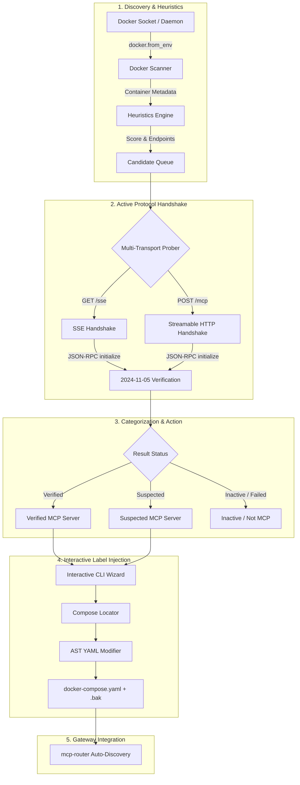

# mcp-scout

<div align="center">

[](https://github.com/spelech/mcp-scout/actions/workflows/test.yml)
[](https://www.python.org/downloads/)
[](https://opensource.org/licenses/MIT)
[](https://modelcontextprotocol.io)
[](https://github.com/astral-sh/ruff)

**Active Docker container discovery, protocol handshake prober, and interactive compose label injector for Model Context Protocol (MCP) servers.**

[Features](#features) • [Installation](#installation) • [Quickstart](#quickstart) • [Architecture](#architecture) • [Label Schema](#docker-compose-label-schema) • [CLI Reference](#cli-reference)

</div>

---

## Overview

In containerized homelabs and microservice architectures, Model Context Protocol ([MCP](https://modelcontextprotocol.io)) servers are frequently deployed across disparate Docker networks, varying exposed ports, and differing transport mechanisms (Server-Sent Events vs. Streamable HTTP).

Manually tracking container IPs, discovery ports, endpoint paths, and wiring up reverse proxies or MCP gateways (such as `mcp-router`) is error-prone. **`mcp-scout`** automates this entire lifecycle:

1. **Discovers** running Docker containers using heuristic candidate scoring.
2. **Probes** candidates with active MCP protocol handshakes (`initialize`, `tools/list`) over SSE and HTTP transports according to the **2024-11-05** protocol specification.
3. **Injects** standardized auto-discovery labels and shared network connections directly into your `docker-compose.yaml` files—preserving YAML comments, quotes, and structure via AST-level manipulation.
4. **Exports** live MCP catalogs in Markdown, JSON, or tabular formats for agent context or documentation.

---

## Features

- 🔍 **Active Docker Discovery**: Scans local or remote Docker daemons for running containers, evaluating image names, entrypoints, environment variables, ports, and existing labels.
- ⚡ **Multi-Transport Protocol Handshaking**:
  - **SSE Prober**: Connects to Server-Sent Events endpoints (`/sse`, `/mcp/sse`), handles session endpoint handshakes, and issues JSON-RPC 2.0 `initialize` calls.
  - **Streamable HTTP Prober**: Sends JSON-RPC 2.0 requests directly to `/mcp`, `/v1/mcp`, `/`, falling back gracefully to HTTP healthchecks.
- 🏷️ **Comment-Preserving Label Injector**:
  - Automatically resolves service `docker-compose.yaml` locations across directory structures.
  - Uses `ruamel.yaml` AST parsing to modify labels without reformatting, stripping comments, or breaking YAML anchors.
  - Generates automatic `.bak` backups before modifying compose files.
- 🌐 **Shared Network Management**: Automatically detects when candidate containers need external shared network attachments (e.g. `shared_net`) for cross-container gateway communication and updates compose definitions accordingly.
- 📋 **Catalog Generation**: Exports discovered servers in Markdown, JSON, or Rich terminal tables.
- 💻 **Interactive CLI Wizard**: Prompt-driven workflow powered by [Rich](https://github.com/Textualize/rich) and [Questionary](https://github.com/tmbo/questionary) for reviewing, configuring, and applying labels with one keystroke.

---

## Architecture & Workflow



---

## Installation

### Using `uv` (Recommended)

```bash
# Install as a standalone CLI tool
uv tool install mcp-scout

# Or run directly without installation
uvx mcp-scout --help
```

### Using `pip`

```bash
pip install mcp-scout
```

### From Source

```bash
git clone https://github.com/spelech/mcp-scout.git
cd mcp-scout
pip install -e ".[dev]"
```

---

## Quickstart

### 1. Scan Docker Daemon for MCP Servers

Scan all running containers and display a summary table of verified, suspected, and labeled MCP servers:

```bash
mcp-scout scan
```

### 2. Interactive Discovery & Label Injection

Launch the interactive terminal wizard to probe containers, inspect candidate endpoints, customize server IDs and paths, and inject compose labels:

```bash
mcp-scout interactive
```

```
🔍 mcp-scout — Interactive Discovery & Label Injector
Scanning Docker daemon for running containers...
Found 14 running containers. Evaluating heuristics & probing candidates...

? Select MCP candidate container to configure:
  ❯ 🟢 mcp-notes-rag (Verified - HTTP)
    🟡 my-analytics-server (Suspected - port 8080)
    ⚪ cancel

? Server Name (mcp.name): notes-rag
? Transport Type (mcp.type): http
? Target Port (mcp.port): 8000
? Endpoint Path (mcp.path): /mcp
? Shared Network to attach: shared_net

✔ Backup created: /containers/cloud/docker-compose.yaml.bak
✔ Successfully updated /containers/cloud/docker-compose.yaml
```

### 3. Generate Catalog

Export your homelab MCP servers into documentation:

```bash
# Export Markdown catalog
mcp-scout catalog --format markdown --output MCP_SERVERS.md

# Export JSON catalog for programmatic routing
mcp-scout catalog --format json
```

---

## Docker Compose Label Schema

`mcp-scout` uses a standardized label schema compatible with [`mcp-router`](https://github.com/spelech/mcp-router)'s `DockerAutoDiscoveryService`:

| Label | Type | Default | Description |
| :--- | :--- | :--- | :--- |
| `mcp.enabled` | `bool` | `true` | Enables auto-discovery for this container. |
| `mcp.name` | `string` | Container name | Unique server identifier used by routing gateways. |
| `mcp.type` | `string` | `sse` \| `http` | Transport protocol (`sse`, `http`, or `stdio`). |
| `mcp.port` | `int` | Detected port | Internal container port for MCP traffic. |
| `mcp.path` | `string` | `/sse` or `/mcp` | URL path endpoint for protocol handshake. |
| `mcp.description` | `string` | Image name | Human-readable server description. |
| `mcp.env.<KEY>` | `string` | — | Environment variables required for MCP connection. |
| `mcp.headers.<HEADER>` | `string` | — | Custom HTTP headers required for requests. |

### Example Compose File

#### Before `mcp-scout`

```yaml
version: "3.8"

services:
  notes-rag:
    image: ghcr.io/spelech/notes-rag:latest
    container_name: mcp-notes-rag
    environment:
      - PORT=8000
    restart: unless-stopped
```

#### After `mcp-scout interactive`

```yaml
version: "3.8"

services:
  notes-rag:
    image: ghcr.io/spelech/notes-rag:latest
    container_name: mcp-notes-rag
    environment:
      - PORT=8000
    restart: unless-stopped
    labels:
      - "mcp.enabled=true"
      - "mcp.name=notes-rag"
      - "mcp.type=http"
      - "mcp.port=8000"
      - "mcp.path=/mcp"
      - "mcp.description=RAG Knowledge Base MCP Server"
    networks:
      - default
      - shared_net

networks:
  shared_net:
    external: true
```

---

## CLI Reference

### `mcp-scout scan`

Scans Docker containers and evaluates/probes for MCP capabilities.

```bash
mcp-scout scan [OPTIONS]
```

**Options:**
- `--network`, `-n` `TEXT`: Docker network name to probe through (default: probes primary container IP or localhost port mappings).
- `--timeout`, `-t` `FLOAT`: Probe connection timeout in seconds (default: `3.0`).
- `--unlabeled-only`: Only display unlabeled candidate servers.
- `--labeled-only`: Only display existing labeled MCP servers.
- `--json`: Output raw probe results as JSON.
- `--compose-root` `PATH`: Root directory for locating `docker-compose.yaml` files.

### `mcp-scout interactive`

Interactive terminal wizard for scanning, configuring, and writing compose labels.

```bash
mcp-scout interactive [OPTIONS]
```

**Options:**
- `--compose-root` `PATH`: Root directory to search for `docker-compose.yaml` files (default: current working directory).
- `--network` `TEXT`: Shared network to recommend when configuring candidates.

### `mcp-scout catalog`

Generates structured catalogs of discovered MCP servers.

```bash
mcp-scout catalog [OPTIONS]
```

**Options:**
- `--format`, `-f` `[table|markdown|json]`: Output format (default: `table`).
- `--output`, `-o` `PATH`: Output file path (default: stdout).
- `--compose-root` `PATH`: Root directory for compose locator.

### `mcp-scout probe`

Directly probe a single container or host target for MCP compliance.

```bash
mcp-scout probe <CONTAINER_OR_HOST> [OPTIONS]
```

---

## Python API

You can also use `mcp-scout` as an async Python library:

```python
import asyncio
from mcp_scout.probe.engine import DiscoveryEngine
from mcp_scout.probe.handshake import ProtocolHandshakeProber

async def main():
    # Run full discovery engine
    results = await DiscoveryEngine.run(timeout=3.0)
    for res in results:
        if res.is_verified:
            print(f"Verified MCP Server: {res.container_name} ({res.resolved_type} on port {res.resolved_port})")

    # Direct handshake probe
    prober = ProtocolHandshakeProber(timeout=3.0)
    result = await prober.probe(
        target_ip="172.18.0.5",
        container_port=8000,
        transport_type="http",
        endpoint_path="/mcp",
        container_name="my-service"
    )
    print(f"Protocol Handshake: {result.status.value}, Server Info: {result.server_info}")

if __name__ == "__main__":
    asyncio.run(main())
```

---

## Development & Testing

### Running Tests

```bash
# Run full test suite with coverage
pytest tests/ -v --cov=mcp_scout

# Run linting & style checks
ruff check .
ruff format --check .
```

### Project Structure

```
mcp-scout/
├── .github/
│   └── workflows/
│       ├── test.yml          # Multi-Python CI (3.10-3.13), lint, test, coverage
│       └── release.yml       # Release packaging & GitHub Release creation
├── mcp_scout/
│   ├── __init__.py           # Package exports & version
│   ├── models.py             # Pydantic data models (ContainerInfo, McpProbeResult, LabelConfig)
│   ├── cli.py                # Typer CLI application commands
│   ├── ui.py                 # Rich UI formatting & Questionary interactive workflows
│   ├── probe/
│   │   ├── __init__.py
│   │   ├── docker_scanner.py # Docker socket inspection & container extraction
│   │   ├── heuristics.py     # Candidate scoring & endpoint permutation heuristics
│   │   ├── handshake.py      # Async SSE & Streamable HTTP protocol prober
│   │   └── engine.py         # Concurrent discovery orchestrator
│   └── injector/
│       ├── __init__.py
│       ├── compose_locator.py # docker-compose.yaml file discovery & service matching
│       └── yaml_modifier.py   # Comment-preserving AST YAML label & network injector
├── pyproject.toml            # Package metadata & build configuration
├── LICENSE                   # MIT License
└── README.md                 # Project documentation
```

---

## License

This project is licensed under the MIT License - see the [LICENSE](LICENSE) file for details.
